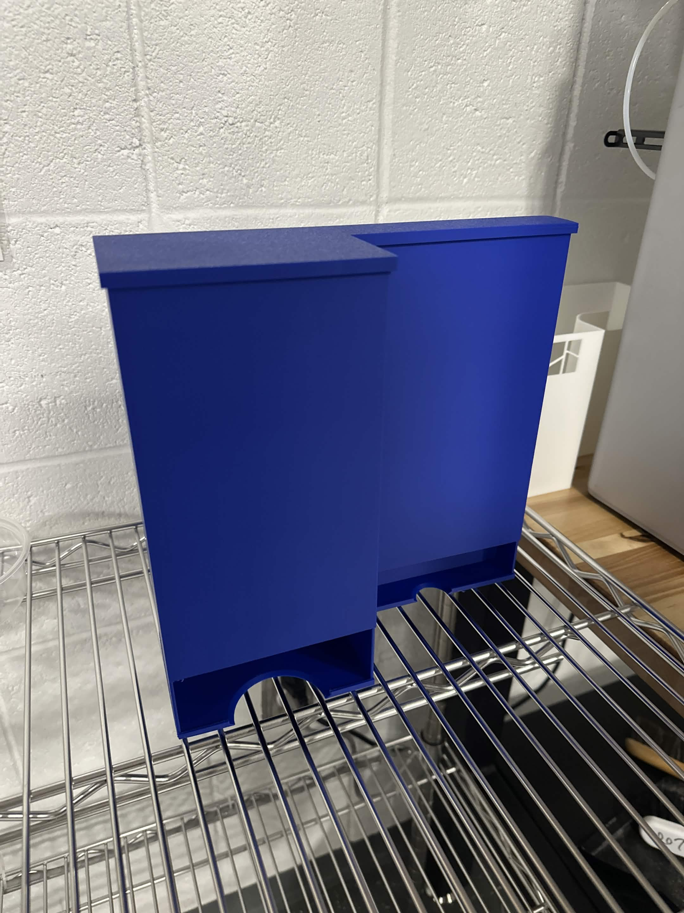

# Anna's Lab Notebook

## 10/5/2026

### Objectives:
Design a sturdy and functional menstrual product dispenser in Fusion 360 that accommodates the dimensions of the pads and tampons used in the ECE Building. Ensure that the design also fits within the build volume of the Bambu Lab X1 Carbon 3D printer.

### Accomplishments: 
I began by renewing my Fusion 360 educational license so that I could start working on the design.

Before creating my own model, I researched existing menstrual product dispenser designs to find inspiration for a simple and durable structure. I came across this [menstrual product dispenser design](https://www.printables.com/model/1333118-menstrual-product-dispenser) on Printables and liked its simplicity. I imported the model into Fusion 360 to see whether I could modify it to fit our project's requirements.

However, modifying the existing model proved difficult because the imported file did not contain the original sketches or design history. As a result, I decided to create my own dispenser from scratch, using the original model as inspiration.

Before beginning, I made sure to have the dimensions of the pads and tampons that the dispenser would hold. I then designed the dispenser in Fusion 360, keeping both the product dimensions and the printer's build volume in mind. Throughout the process, I also refreshed my CAD skills, as it had been a while since I last used Fusion 360.

By the end, I successfully created separate 3D models for the dispenser box and its lid. Both models are linked below:

[View the 3D dispenser box model](https://github.com/annwilkowski/Menstrual-Product-Bathroom-Tracker/tree/main/notebooks/Anna/3D-Print/Dispenser_Box.stl)

[View the 3D dispenser lid model](https://github.com/annwilkowski/Menstrual-Product-Bathroom-Tracker/tree/main/notebooks/Anna/3D-Print/Dispenser_Lid.stl)

## 10/7/2026

### Objectives:
3D print the dispenser box and lid designed in Fusion 360. 

### Accomplishments: 
I was unable to print the models because Design Reviews were still taking place in the room with the 3D printer. However, I downloaded Bambu Studio and used it to slice both the dispenser box and lid models, generating the files needed for 3D printing. This allowed me to prepare both models for printing once the printer became available. 

[Link to dispenser box gcode file](https://github.com/annwilkowski/Menstrual-Product-Bathroom-Tracker/tree/main/notebooks/Anna/3D-Print/Dispenser_Box.gcode.3mf)
[Link to dispenser lid gcode file](https://github.com/annwilkowski/Menstrual-Product-Bathroom-Tracker/tree/main/notebooks/Anna/3D-Print/Dispenser_Lid.gcode.3mf)

## 10/8/2026

### Objectives:
3D print the dispenser box and lid using the Bambu Lab X1 Carbon printer.

### Accomplishments: 
I received approval from a TA to use the 3D printer and began the printing process. I encountered a minor issue with the SD card, which needed to be formatted correctly for the printer to recognize it. Fortunately, I was able to resolve this using the printer's built-in formatting option.

After resolving the issue, I was able to proceed with printing the models. A timelapse of the printing process is linked below.

<video src="3D-Print/Printing_Timelapse.mp4" width="50%" controls></video>

## 10/10/2026

### Objectives:
Make modifications to the box lid to make it fit the dispenser box better. 

### Accomplishments: 
After reviewing the original dispenser lid design, I realized that I had made a few mistakes. The lid was inverted relative to the dispenser box, and some of my original dimensions were incorrect, preventing the two components from fitting together properly.

I returned to Fusion 360 and modified the lid to correct its orientation and dimensions. After making these adjustments, I exported an updated STL file and used Bambu Studio to generate a new sliced file for printing.

The updated design and printing files are linked below:

[View the 3D dispenser lid 2.0 model](https://github.com/annwilkowski/Menstrual-Product-Bathroom-Tracker/tree/main/notebooks/Anna/3D-Print/Dispenser_Lid_2.0.stl)

[Link to dispenser lid 2.0 gcode file](https://github.com/annwilkowski/Menstrual-Product-Bathroom-Tracker/tree/main/notebooks/Anna/3D-Print/Dispenser_Lid_2.0.gcode.3mf)

Finally, I successfully printed the completed dispenser and confirmed that the box and lid fit together properly. The final design is fully assembled and functional, as shown in the image below. 

